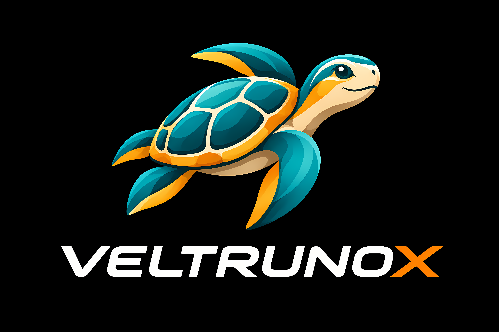

# Veltrunox

**V**ersatile **E**ngine for **L**ooping, **T**uning, **R**ehearsal, **U**ploads, **N**avigation, **O**rganization & e**X**change.

<p align="center"></p>

Veltrunox helps bands during rehearsals. Recordings live on a server together with bookmarks: labels mark points, regions mark sections. A client plays the whole recording, starts at a label, or loops a region, so nobody searches for the same passage again and again. All connected clients see and control the same playback in real time.

## Planned features

- Server-side library of recordings with labels and regions, editable from every client.
- Shared, real-time playback position across all clients, with scrubbing where possible.
- Waveform control for orientation and for setting and editing labels and regions.
- Detection of tuning (for example 412 Hz), key (for example A major) and tempo (bpm); tuning and key can be adjusted.
- Playback speed from 0.5× to 2× at constant pitch, also by entering a target tempo.
- Upload and management of recordings from the client.
- Roles: admin, user and an optional guest.

## Status

Early scaffold. A Rust workspace with a first vertical slice (server lists recordings, client core fetches them) exists; a Flutter web app lists them. Architecture and coding rules are in `docs/`.

## Technology

Rust for server and client core, Flutter for the user interface. The browser (WebAssembly) is the first client target.

## Development

```sh
cargo test --workspace
VELTRUNOX_ADDRESS=127.0.0.1:8080 cargo run -p veltrunox-server
```

Web app (needs Flutter, `wasm-pack`, `flutter_rust_bridge_codegen` 2.13.0 and the `wasm32-unknown-unknown` target):

```sh
scripts/build-web.sh
```

Browser test (after `scripts/build-web.sh`; needs Node):

```sh
cd e2e && npm ci && npx playwright install chromium && npx playwright test
```

To run the app by hand, serve `build/web` and start the server with `VELTRUNOX_ALLOWED_ORIGIN=<origin of the web app>`; the app reads the server URL from `--dart-define=VELTRUNOX_SERVER_URL=...` (default `http://127.0.0.1:8080`).

## Documentation

| Path | Content |
|---|---|
| `docs/architecture/Architecture.md` | Architecture |
| `docs/architecture/adr/` | Architecture decisions |
| `docs/development/Clean-Code.md` | Coding guidelines |
| `docs/development/GUI-Architecture.md` | GUI architecture |
| `docs/logo/` | Logo |
| `docs/validation/` | Verification results and their limits |
| `CHANGELOG.md` | Changes |

## License

GNU General Public License v3.0 only. See `LICENSE`.
