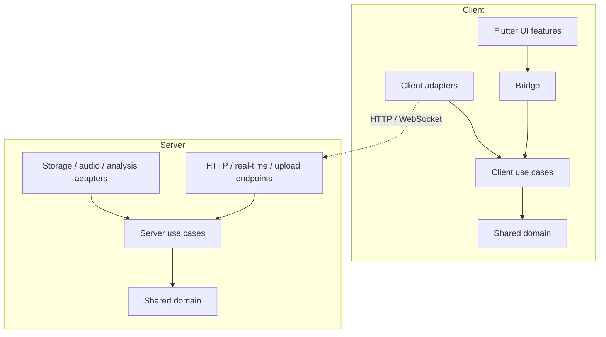

# Veltrunox – Architecture

**Status:** Draft  
**Version:** 0.1  
**Date:** 2026-11-21  
**Server:** Rust  
**Client:** Rust client core and Flutter user interface; browser (WebAssembly) first

## 1. Core decisions

- A server holds recordings, bookmarks (labels and regions), users and the shared playback state. Clients connect to it over HTTP and a real-time channel. No cloud service.
- The server plays the audio (for example on the rehearsal-room speakers). Clients output no audio; they control and display the shared playback state in real time. The server is the single authority for that state and decides concurrent changes.
- Rust implements the server and the client core (application logic, protocol, state). Flutter implements only the user interface (ADR-001).
- Clean Architecture determines the direction of dependencies. IOSP separates domain decisions and operations from their coordination. IODA structures the code where it clarifies the flow of data (see Clean-Code).
- Event streams (playback position, remote changes, scrubbing) use `rxrust` where a stream is the natural model. Domain decisions stay synchronous and free of stream types.
- The GUI follows Recursive Separation of Concerns with feature-oriented component composition (ADR-002, `GUI-Architecture.md`).

## 2. Structure and dependencies

Solid arrows show source-code dependencies. Use cases define the ports they need; adapters implement them. Runtime calls to the outside go through these ports. The shared domain is one crate used by both sides.

| Area | Responsibility |
|---|---|
| Domain core | Recording, label, region, playback state, tempo and pitch values, roles and permissions, validation rules, time and position arithmetic |
| Server application | Library management, upload and analysis workflow, bookmark editing, playback transport, user management, authorisation |
| Client application | Session and connection handling, local view state derived from the shared state, editing intents, waveform viewport logic |
| Inbound adapters | HTTP and WebSocket endpoints (server); Flutter bridge calls (client) |
| Outbound adapters | Persistence, file storage, audio decoding, time stretching, audio output, analysis, password hashing, HTTP/WebSocket client |
| Start-up modules | Load configuration, wire up concrete adapters, start services and background tasks |

Integrations coordinate operations and pass their results on. Rules such as "may this role change the region?" or "which playback rate results from a target tempo?" live in separately testable operations. Technical error handling and asynchronous coordination stay in the responsible flow; artificial micro-functions are not required.

### Rust layout

A Cargo workspace with the following boundaries (all crates exist; some are still thin):

| Crate / program | Content |
|---|---|
| `veltrunox-core` | Domain types and pure operations, shared by server and client |
| `veltrunox-protocol` | Versioned messages and encoding for HTTP and the real-time channel; no system access |
| `veltrunox-server-app` | Server use cases and their port traits; depends on `veltrunox-core` |
| `veltrunox-client-app` | Client use cases, session state and viewport logic and their port traits; depends on `veltrunox-core` |
| `veltrunox-server-adapters` | Persistence, file storage, audio decoding, time stretching, audio output, analysis, security, HTTP and WebSocket endpoints |
| `veltrunox-client-adapters` | HTTP and WebSocket client, platform integration |
| `veltrunox-server` | Server entry point and wiring |
| `veltrunox-client-bridge` | Entry point of the client core; exposes a narrow API to Flutter (`flutter_rust_bridge`) |

Core and application crates import neither adapters nor UI, network, database or runtime types. Protocol types are translated into application commands at the entry point. Crates that must compile to WebAssembly avoid dependencies that do not support that target. Further crates are added only at an actual module or build boundary.

States are modelled with `enum`, identifiers with dedicated types and expected errors with `Result`. Traits sit at replacement and test boundaries. Asynchronous execution and bounded channels belong to the runtime; domain decisions stay synchronous. Time and randomness are supplied in a controllable way.

### Flutter layout

The Flutter project holds only presentation: feature folders (for example library, player, waveform, bookmarks, tuning, upload, administration), a small shared design system, and the generated bridge bindings. Features follow `GUI-Architecture.md`. The Flutter code depends on the bridge API, never on server endpoints or storage.

## 3. Ports and adapters

| Port | Purpose / adapter |
|---|---|
| `RecordingRepository` | Store recordings, bookmarks and analysis results transactionally |
| `MediaStore` | Store and read audio files and derived data (waveform peaks) |
| `AudioDecoder` | Decode uploaded audio to samples for analysis and waveform generation |
| `TimeStretcher` | Change speed without changing pitch; shift pitch independently |
| `RecordingAnalyzer` | Determine reference tuning, key and tempo |
| `UserRepository` | Store users, roles and password hashes |
| `PasswordHasher` | Hash and verify passwords with a suitable algorithm |
| `SessionTokens` | Issue and verify authentication tokens |
| `PlaybackBroadcast` | Distribute the shared playback state and changes to connected clients |
| `Clock` | Controllable time source |
| `AudioOutput` | Server side: play processed samples on the server's audio device and set its volume |
| `ServerLink` | Client side: requests and real-time stream to the server |

## 4. Shared playback state

The server holds one playback state: current recording, position, run/pause, speed, tuning, key, play range, play mode and the output volume. The play range is the region being played; the play mode (to the end of the recording, to the end of the region, loop) decides what happens at its end (ADR-010). Speed, tuning and key are stored with the recording and restored when it is loaded; analysis results are never overwritten by them. The volume belongs to the room, not to a recording; the server applies it to the sound card's mixer or, without one, as gain (ADR-009). Clients send intents (for example "seek", "play region", "set play mode", "set speed"). The server validates the permission and the intent, applies it, and publishes the new state to all clients. Clients render the published state and do not keep a divergent copy.

Scrubbing sends a throttled stream of position intents that all clients follow continuously; the server plays short audible pieces at the scrubbed position (ADR-011). Every update carries the complete state with a strictly increasing revision, so joining, reconnecting and lost messages need no separate catch-up. Position is transmitted as a reference point (position plus server time) so clients can extrapolate while playing.

## 5. Real-time and streams

`rxrust` observables model sequences of events at the edges of the client core: incoming server messages, throttled scrubbing input, position ticks, connection status. Operators such as throttle, debounce and distinct-until-changed belong to the flow, not to domain operations. A stream stays inside the component that owns it; other components receive explicit values or narrow handles. Requests with a single response use plain asynchronous calls.

## 6. Security

- Authentication with user name and password; the server stores only password hashes. Roles are admin, user and an optional guest. The guest role is a server setting that is off by default.
- Every action is authorised on the server. The user interface may hide actions, but it never grants them.
- Input is validated at system boundaries: uploads (format, size), messages, identifiers and ranges.
- Transport security (TLS) is required except for an explicitly documented local-network setup. Secrets never appear in logs.

## 7. Quality attributes

- Domain logic (time and pixel arithmetic, snapping, region rules, tempo and pitch calculations, permission decisions) is testable without network, audio or GUI.
- The server is a single process with an embedded store; no external database service is required.
- Audio output, time stretching and analysis must run in real time on the target hardware, including a Raspberry Pi.
- Real-time latency and audio quality are measured; results and limits go to `docs/validation/`.
